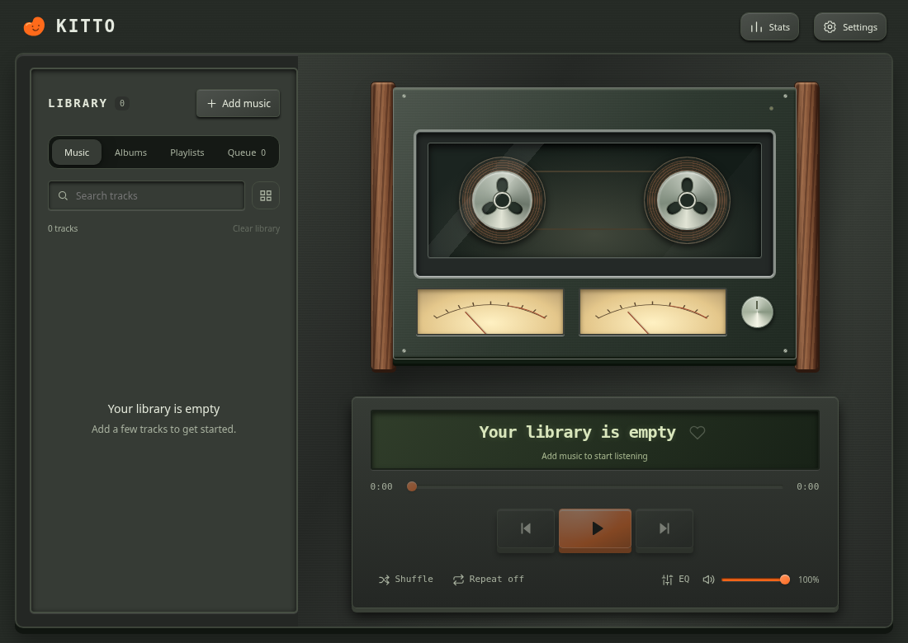

# Kitto

**i got tired of spotify.**

i already had the music. i wanted to open the files, pick a track, and get on with my day. so i made Kitto.


**[Download Kitto](https://github.com/Yunykk/Kitto/releases/latest)** · [Install](#install) · [Run from source](#run-from-source)

## Put a track on

Open **Add music** and pick the files you want to hear. Search by track, artist, album, or filename. You can play a whole album, build playlists, or pull up your liked songs. Kitto remembers your queue and where you stopped.

On desktop, add a music folder in **Settings** and rescan when it changes. Keep imported files at their original paths. Use the mini player when you want the controls within reach.



*Tapeless Tape Deck. This is the actual browser UI. File import and playback require the native app.*

<details>
<summary>Change the sound, or just the furniture</summary>

Pick a theme and accent in **Settings**. Try the 10-band EQ or choose a tuning preset, then switch back to **Original**. Presets move the pitch without changing tempo and assume the recording uses A4 = 440 Hz. **Stats** fills in as you listen.

</details>

## Install

Pick the build for your device from [GitHub Releases](https://github.com/Yunykk/Kitto/releases/latest).

| Device | What to grab |
| --- | --- |
| Windows x64 | Run the `x64-setup.exe` installer, then open Kitto from the Start menu. |
| Linux x64 | Choose DEB, RPM, or AppImage. See the [Linux guide](docs/linux.md#install) for package commands and codecs. |
| Android ARM64 | Open the signed `android-arm64.apk` on Android 7.0 or newer. Allow installation from the app opening the file if Android asks. |

If you already have a debug build on Android, uninstall that build before installing the signed preview. Android requires matching signing keys for updates, and uninstalling clears Kitto's library and settings.

Kitto has no streaming catalog, account, or shared listening sessions. On Linux, supported audio formats depend on installed GStreamer codecs. Android is a preview.

## Run from source

Use Node.js 22.12+ and npm.

```bash
git clone https://github.com/Yunykk/Kitto.git
cd Kitto
npm ci
npm run dev
```

Open the Vite address for the UI preview. Stop Vite before starting the native app to free port `1420`.

- **Windows.** Install [Rust](https://rustup.rs/) with the MSVC toolchain, Visual Studio Build Tools 2022 with **Desktop development with C++** and a Windows SDK, and WebView2. Use `npm run tauri dev` to launch and `npm run tauri build -- --bundles nsis` to build the installer.
- **Linux.** Install the [native dependencies](docs/linux.md#build-from-source). Run `npm run linux:check`, then `npm run linux:dev`. Build packages with `npm run linux:build -- --ci`.
- **Android.** Follow the [Android guide](docs/android.md) for setup, signing, and APK validation.

Run `npm run check` and `npm test` for frontend checks.

<details>
<summary>Keyboard shortcuts and audio credits</summary>

| Keys | Action |
| --- | --- |
| Space | Play or pause |
| Ctrl + Left / Right | Previous or next track |
| Left / Right | Seek five seconds |
| Up / Down | Change volume by five percent |

Kitto uses Svelte, TypeScript, and Tauri. [Third-party audio notices](public/THIRD_PARTY_NOTICES.txt)

</details>
