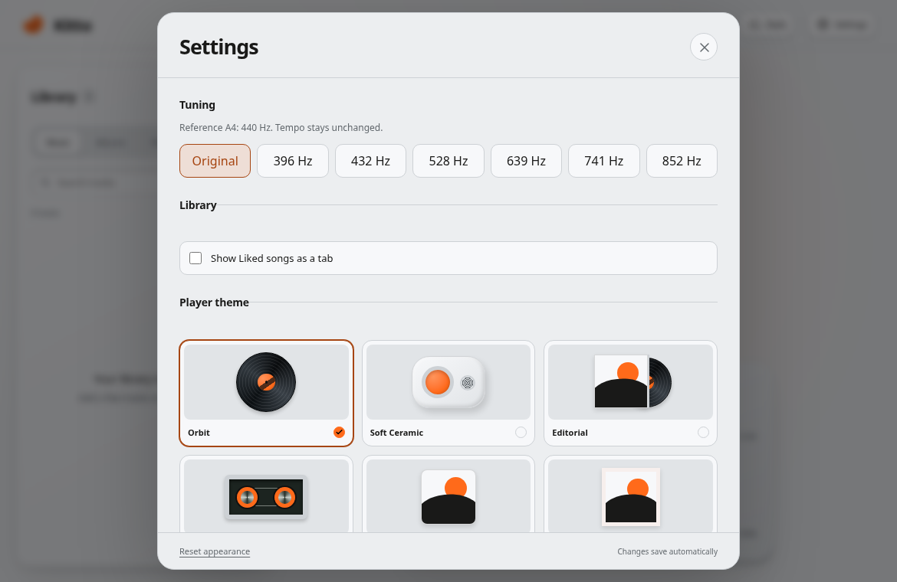

# Kitto

**i got tired of spotify.**

I wanted a player for the files I keep. Kitto opens your own music, remembers where you left off, and gives you room to change how it looks and sounds.

**[Download Kitto](https://github.com/Yunykk/Kitto/releases/latest)** · [Linux guide](docs/linux.md) · [Android guide](docs/android.md)



*Appearance settings in the browser preview. Import and playback use the native app.*

## Get it running

- **Windows x64** — Download and run the `x64-setup.exe` installer. Open Kitto from the Start menu.
- **Linux x64** — Pick the DEB, RPM, or AppImage from the release assets. Use the [Linux installation guide](docs/linux.md#install) for package commands, codecs, and the AppImage fallback.
- **Android preview** — On an ARM64 device with Android 7.0 or newer, download the signed `android-arm64.apk`. If prompted, allow installs from the app opening it. A previously installed debug build must be removed first because the signing keys differ. Uninstalling clears Kitto's saved library and settings.

Open Kitto, hit **Add music**, and choose a few local audio files. On desktop, you can also add folders in **Settings** and rescan them later. Keep files at their imported paths so Kitto can find them again.

## Make it yours

- Search by track, artist, album, or filename. Build playlists, save liked songs, or browse albums in disc order.
- Use the queue, shuffle, repeat, and the desktop mini player. Kitto saves your queue and playback position locally.
- Pick a theme and accent, adjust the 10-band equalizer, or try a tuning preset. The pitch shift keeps the tempo and assumes the recording uses A4 = 440 Hz.
- Open **Stats** to see listening history as it builds up.

## Run from source

Use Node.js 22.12+ and npm for the frontend.

```bash
git clone https://github.com/Yunykk/Kitto.git
cd Kitto
npm ci
npm run dev
```

Open the Vite address for a UI preview. For native development, stop Vite first to free port `1420`, then use the command for your platform.

- **Windows** — Install [Rust](https://rustup.rs/) with the MSVC toolchain, Visual Studio Build Tools 2022 with **Desktop development with C++** and a Windows SDK, and WebView2. Run `npm run tauri dev`. To build the NSIS installer, run `npm run tauri build -- --bundles nsis`.
- **Linux** — Install the native dependencies in the [Linux guide](docs/linux.md#build-from-source), then run `npm run linux:check` and `npm run linux:dev`. Build packages with `npm run linux:build -- --ci`.
- **Android** — See the [Android guide](docs/android.md) for SDK setup, signing, and APK validation.

Run `npm run check` and `npm test` for frontend checks.

## Current limits

Bring your own audio files. Kitto has no streaming catalog, account, or shared listening sessions. Linux playback depends on the available GStreamer codecs. The Android APK is a preview distributed through GitHub Releases.

<details>
<summary>Keyboard shortcuts and audio credits</summary>

| Keys | Action |
| --- | --- |
| Space | Play or pause |
| Ctrl + Left / Right | Previous or next track |
| Left / Right | Seek five seconds |
| Up / Down | Change volume by five percent |

Kitto uses Svelte, TypeScript, and Tauri. See [audio processing notices](public/THIRD_PARTY_NOTICES.txt) for third-party credits.

</details>
